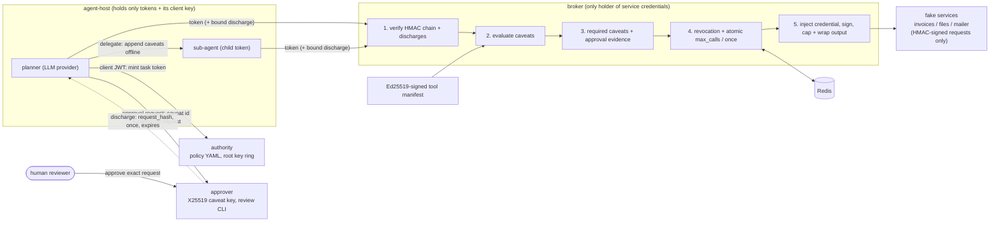

# capability-tool-broker

Agents hold unforgeable macaroon capabilities that can only be narrowed, never ambient keys. A
broker injects the real service credentials and requires human approvals bound to the exact
request.

## Problem

Agent tools usually run with the full authority of the host process: the API keys in its
environment, the files it can open, the endpoints it can reach. One prompt injection in a document
the agent reads reaches all of it, and sub-agents inherit everything. Role-based access control on
an agent identity cannot express a grant like "this sub-step may read invoice 42 for five minutes,
at most three times", and it cannot shrink that grant for a sub-agent without a round trip to an
identity provider.

This repository implements object-capability security for agent tools:

- the **authority** mints one HMAC-chained macaroon per task from a policy template;
- agents **attenuate offline**: a planner hands a sub-agent a narrower token by appending caveats,
  and nobody can remove a caveat without the root key;
- the **broker** is the only process with service credentials. It verifies the token, evaluates
  every caveat against the concrete call, commits call counters atomically, injects the credential
  and calls the service;
- writes and deletes need a **discharge** from the **approver**, which a human issues for one exact
  canonical request, usable once.

The evaluation compares this against the common pattern where the agent host holds the keys.

## Architecture



One image, four compose entrypoints (`serve authority|broker|approver|services`) plus Redis; the
agent host runs the scripted end-to-end check (`e2e start|resume`).

| Component | Holds | Code |
|---|---|---|
| Macaroon library (HMAC-SHA256 chains, V2 binary format) | nothing | `src/capability_tool_broker/macaroons/` |
| Caveat DSL, verifier, key ring, approval caveats | nothing | `src/capability_tool_broker/capabilities/` |
| Authority (client JWT authn, policy, minting) | root key ring, approver public key | `src/capability_tool_broker/authority/` |
| Approver (queue, discharges, review CLI) | X25519 caveat key | `src/capability_tool_broker/approver/` |
| Broker (pipeline, signed manifest, Redis state, metrics) | root key ring, service credentials | `src/capability_tool_broker/broker/` |
| Agent host (planner, sub-agents, ambient baseline) | its client key, tokens | `src/capability_tool_broker/agent/` |
| Fake services | their own credential | `src/capability_tool_broker/services/` |
| Evaluation harnesses | generated keys | `src/capability_tool_broker/evaluation/` |

**Caveats.** First-party caveats are one canonical line each and are parsed, never evaluated as
code: `task_id = T`, `client in A`, `tool in A,B`, `verb in read,write`, `host in H`,
`resource matches invoice/42,invoice/4*` (globs with segment-bounded `*`, `?` and `**`),
`expires < 2026-09-13T12:00:00Z`, `max_calls <= 3`, `once = <nonce>`, `request_hash = <sha256>`
and argument predicates such as `arg amount <= 500`. Unknown or non-canonical caveats deny.

**Delegation.** `delegate(tools, resources, verbs, max_calls, ttl)` appends caveats to the parent's
token. Because caveats are conjunctive, a child that asks for `invoice/*` while its parent holds
`invoice/42` still gets only `invoice/42`. `max_calls` counters are keyed by the chain signature
right after the caveat, so every copy of a token prefix shares one counter, and a counter lives as
long as that prefix's own expiry, so a short-lived child cannot make the broker forget it.

**Approvals.** Templates that grant write or delete get a third-party caveat scoped to
`verb in write,delete` (reads need no approval), sealed to the approver and tagged by the authority.
After a human approves the canonical request (tool, verb and host from the manifest, resource,
arguments, task), the approver mints a discharge carrying `request_hash`, `task_id`, a two-minute
`expires` and a `once` nonce; the agent binds it to its token. The approver accepts approval
requests only from the client the token was minted for. See
[ADR 0003](docs/adr/0003-approvals-as-authority-tagged-scoped-discharges.md).

## Quickstart

Requirements: [uv](https://docs.astral.sh/uv/) and Python 3.12. Everything below runs offline on a
CPU; no API key is needed.

```bash
uv sync --frozen
uv run python tasks.py demo        # delegation, contained injection, CLI approval, replay denied
uv run python tasks.py test        # pytest with coverage (floor 85%)
uv run python tasks.py bench       # soundness, stateful, forgery, escalation, latency
uv run python tasks.py lint typecheck audit baseline
```

To answer the approval prompt yourself, run `uv run capability-tool-broker demo --interactive`.

What the demo prints (abridged): the task token's caveats; the sub-agent's appended caveats; the
sub-agent reading invoice 42 and then obeying three instructions injected into its notes, each
denied with the failing caveat (`resource matches invoice/42`, `tool in invoices_read`,
`tool in invoices_read,invoices_update_status`); the planner's status change waiting on CLI
approval with the full canonical request shown to the reviewer; the approved call executing once;
a replay of the discharge denied (`replayed`) and its reuse for different arguments denied by the
discharge's `request_hash` caveat; and the audit chain verified against its signed checkpoint, with
an edited copy and a truncated copy both detected.

Compose stack (built locally, fake services and Redis; CI runs this in the `compose-integration`
job):

```bash
uv run capability-tool-broker keygen --out .env          # per-role keys; never commit .env
set -a && . ./.env && set +a
uv run capability-tool-broker sign-manifest --out deploy/local/manifest.signed.json
docker compose up --build --detach --wait
docker compose run --rm agent-host e2e start              # delegation, denials, pending approval
docker compose exec approver capability-tool-broker approver review
docker compose run --rm agent-host e2e resume             # approved write runs once, replay denied
```

## Results

All numbers below were produced by one run of

```bash
uv run python bench/bench_baseline.py --check
```

on Windows 10 (10.0.19045), Python 3.12.14, an Intel64 Family 6 Model 158 CPU with 6 logical cores,
CPU only, offline. Section run times: soundness 255.1 s, stateful 13.2 s, forgery 1.6 s,
escalation 6.4 s, latency 67.8 s (5 min 46 s in total). The script exited 0 with "all benchmarks
within thresholds"; CI enforces the same thresholds (`bench/thresholds.json`). Tables copied
verbatim:

### Soundness (reference evaluator over a 900-request universe)

| chains | requests/chain | verifications | mismatches | child not subset | non-empty |
|---:|---:|---:|---:|---:|---:|
| 2000 | 900 | 3600000 | 0 | 0 | 1128 |

Mean fraction of the universe a parent authorizes: 0.1279

Universe: 5 tools x 20 resources x 3 verbs x 3 time steps. Each chain has 1 to 6 random caveats
(task, client, tool, verb, host, resource globs, expiry, argument predicates, `max_calls`, scoped
approval caveats); each child appends 1 to 3 more. The reference evaluator shares no code with the
DSL, parser, glob matcher or verifier. 1,128 of 2,000 parents authorize at least one request, so the
comparison is not dominated by empty sets. The check is exhaustive over the 900 requests for each
of the 2,000 chains, which is a finite sample of chains, not a proof.

### Stateful semantics (sequential model)

| sequences | steps | calls | allowed | denied by state | mismatches |
|---:|---:|---:|---:|---:|---:|
| 1000 | 40000 | 16617 | 3043 | 3099 | 0 |

The soundness oracle checks stateless decisions only. Each of these sequences drives the full
broker (verifier, approval policy, state store) through 40 random steps: reads with the root token
or any delegated descendant, delegations that append a short expiry and/or a `max_calls` caveat,
human approvals, discharges with an appended expiry, writes with any token and discharge, and
clock jumps of 1 to 400 s (past the state store's 300 s grace period). The reference model tracks
every counter by the caveat prefix its holders share and every approval by id, and never forgets
state, so a store that drops a counter or nonce while some holder can still present it is a
mismatch. 3,099 of 16,617 calls were denied by state alone (exhausted counters or used approvals).
`tests/integration/test_evaluation.py::test_the_stateful_model_detects_a_store_that_forgets_its_state`
shows that the harness reports mismatches for a store that admits every commit.

### Forgery suite

| category | attempts | accepted |
|---|---:|---:|
| byte_flips_token | 2340 | 0 |
| byte_flips_discharge | 1896 | 0 |
| base64_mutations | 2080 | 0 |
| caveat_removal | 33 | 0 |
| caveat_reordering | 21 | 0 |
| signature_splicing | 10 | 0 |
| discharge_misuse | 9 | 0 |
| key_confusion | 3 | 0 |
| **total** | 6392 | 0 |

Controls (valid read, approved write, attenuated read) accepted: True

### Confused-deputy and escalation scenarios

| family | scenarios | unauthorized effects: broker | unauthorized effects: ambient keys |
|---|---:|---:|---:|
| undelegated_tool | 4 | 0 | 4 |
| widened_glob | 4 | 0 | 4 |
| expired_token | 4 | 0 | 4 |
| exhausted_max_calls | 5 | 0 | 9 |
| replayed_discharge | 5 | 0 | 10 |
| injection_read | 4 | 0 | 5 |
| injection_exfiltration | 4 | 0 | 4 |
| injection_destructive | 3 | 0 | 3 |
| verb_escalation | 2 | 0 | 2 |
| discharge_misuse | 3 | 0 | 3 |
| token_tampering | 4 | 0 | 5 |
| **total** | 42 | 0 | 53 |

Scenarios with at least one unauthorized effect: broker 0/42, ambient keys 42/42.
Utility: 30/30 benign tasks completed under least-privilege tokens (ambient keys: 30/30).

Effects are counted at the fake services, not in agent logs. The ambient baseline runs the same
scripts with the service keys in the host process; it completes the benign tasks too, so least
privilege cost no utility on this task set. Two scenarios combine attenuation with clock jumps past
the state store's grace period: a one-second child token exhausts the shared counter and the parent
retries later (`short-lived-child-cannot-reset-counter`), and a discharge is used with a one-second
expiry appended, then the original is replayed later (`attenuated-discharge-outlives-nonce`). The
scenarios are scripted and written by the author of the broker: they show that the enumerated attack
patterns are contained, not that no other attack exists.

### Latency (median over 3 repeats)

| benchmark | calls per repeat | repeats | p50 (us) | p99 (us) | p99 range (us) | mean (us) |
|---|---:|---:|---:|---:|---:|---:|
| verify_10_caveats | 5000 | 3 | 158.6 | 366.7 | 333.8 to 392.8 | 170.2 |
| decide_write_with_discharge | 2500 | 3 | 472.8 | 1213.7 | 1130.9 to 1774.8 | 506.7 |
| broker_call_in_process | 1000 | 3 | 17702.2 | 29478.8 | 28843.7 to 30444.6 | 18248.1 |
| broker_call_no_audit | 1000 | 3 | 594.9 | 1247.1 | 1131.9 to 1475.0 | 641.4 |
| broker_call_http | 300 | 3 | 2995.4 | 4480.3 | 4013.9 to 5476.2 | 3194.3 |

Each benchmark is repeated three times; the table shows the median of the per-repeat p50, p99 and
mean, and the lowest and highest per-repeat p99. p99 values move by tens of percent between
repeats on this machine, so the range is the number to quote, not a single p99.
`verify_10_caveats` (parse and verify a 10-caveat token) meets the p99 < 2 ms target in every
repeat. `broker_call_in_process` includes two fsync'ed audit appends per call (the write-ahead
`broker.authorize` record and the `broker.execute` outcome), which dominate on this Windows
machine; `broker_call_no_audit` is the same call without the audit log. `broker_call_http` goes
through the FastAPI app in-process (no network) and does not write an audit log. Services are
in-process fakes, so these are broker overheads, not end-to-end API latencies.

## Security

Controls, each linked to its tests in [CLAIMS.md](CLAIMS.md) and the
[threat model](docs/THREAT_MODEL.md) (STRIDE, including confused deputy, token theft and discharge
replay):

- **No ambient authority.** Service credentials exist only in the broker's environment (and the
  fake services' own copy); the compose file, the per-role settings classes and the live object
  graph of the agent host and approver are checked for leaks.
- **Isolated broker state.** In compose, Redis and the fake services sit on an internal network
  that only the broker joins, and Redis requires a password that only Redis and the broker's
  `BROKER_REDIS_URL` receive, so an agent host cannot reset counters, nonces or revocations.
- **Unforgeable, attenuation-only tokens.** HMAC-SHA256 chains compared in constant time, strict
  canonical decoding, key ids with a dual-key rotation window
  ([runbook](docs/RUNBOOK_KEY_ROTATION.md)); authorized sets compared with an independent
  reference evaluator over a 900-request universe for 2,000 random chains.
- **Approvals bound to the request.** Discharges carry the canonical request hash and a single-use
  nonce, are bound to the token family, and count as evidence only for authority-tagged caveats;
  the approver key is separate from the root key, and the approver accepts requests only from the
  token's own client.
- **Signed tool manifests.** Verb, host, route mapping, credential and required caveat types come
  from an Ed25519-signed manifest; an unsigned or modified manifest fails readiness and every call.
- **Broker-only access to services.** Services accept only HMAC-signed requests with fresh nonces.
- **Call limits.** Per-token `max_calls` enforced by the broker: atomic, shared by delegated
  copies, living as long as the shared chain prefix (a short-lived child cannot reset it), and not
  consumed by denied calls or by calls that never reached a service. A sequential reference model
  checks these semantics on random call sequences. Per-task step, LLM token and USD budgets are
  enforced by the agent host for its sub-agents: they bound cost and runaway loops but are not an
  authorization boundary (see Non-goals).
- **Prompt-injection suite.** Scripted models that obey every injected instruction cannot exceed
  their token's authority; tool output is capped and wrapped as untrusted data.
- **Audit, authn, limits.** Hash-chained audit of mint, attenuate, deny (with the failing caveat),
  discharge, authorize and execute. The broker writes its `broker.authorize` record before any
  state commit or effect and denies the call if it cannot; each role signs a checkpoint of its log
  after every append and refuses to reopen a log that was truncated, rolled back or rebuilt. EdDSA
  client-credential JWTs per service audience; token-bucket rate limits per authenticated client;
  body, token and output size limits; PII redaction in logs and audit records.
- **Operations.** `/readyz` checks root key, Redis and manifest signature; metrics
  `capability_decisions_total{result,caveat_type}`, `verify_latency_seconds`,
  `broker_call_latency_seconds`; the broker span joins the agent step's trace via `traceparent`.

Design decisions: [ADR 0002 macaroons over JWT and Biscuit](docs/adr/0002-macaroons-over-jwt-and-biscuit.md),
[ADR 0003 approvals as scoped, authority-tagged discharges](docs/adr/0003-approvals-as-authority-tagged-scoped-discharges.md),
[ADR 0004 stateless checks before state commits](docs/adr/0004-stateless-checks-before-state-commit.md).
Reporting vulnerabilities: [SECURITY.md](SECURITY.md).

## Non-goals

- **Process isolation of tool code, and a compromised agent host.** The broker calls remote
  services; it does not sandbox code running on the agent host. A compromise of the agent host
  process gets its tokens and its client private key. The client key is minting authority within
  the policy: the attacker can request any template the policy grants that client, with parameters
  of its choosing, so with the default policy it can read any invoice (`invoice-audit`) and ask
  for approvals on any invoice id. Writes and deletes still need a human approval of the exact
  request. Binding mints to task grants the host cannot forge is not implemented; sandboxing is
  the subject of a separate project.
- **Budgets as an authorization boundary.** Step, LLM token and USD budgets run in the agent host,
  and a compromised host ignores them; the broker enforces per-token `max_calls`, expiry and rate
  limits only.
- **Audit integrity against a compromised writer.** Signed checkpoints detect a truncated,
  rolled-back or rebuilt log by anyone who cannot also rewrite the checkpoint with its key.
  Restoring an older log together with its older checkpoint is not detected, and compose keeps
  checkpoints on a second volume of the same container rather than on a separate host.
- **Public verifiability.** Macaroons are verified with the shared root key; there is no
  public-key token format and no third-party verifier.
- **Distributed revocation and multi-replica state.** Revocation is short expiry plus a denylist
  keyed by the root token id (revoking a token revokes all its attenuations, not a single child).
  Rate-limit buckets and the JWT replay cache are per process.
- **Real identity providers and SaaS connectors.** Clients are registered by public key in
  settings; the three services are fakes that stand in for real APIs.
- **Reviewer authentication.** The review CLI records a configured reviewer name; access to the
  approver container is the control.
- **Live model runs.** Every test, the demo and the benchmarks use scripted `FakeProvider` models.
  `AnthropicProvider` (default `claude-opus-5`, adaptive thinking, strict tools, refusal fallback)
  is unit-tested against a mocked client only; no cassettes were recorded.

Deviations from the original specification, recorded honestly:

- Rate limiting uses the baseline's token-bucket middleware instead of `slowapi` (same control, no
  extra dependency).
- The macaroon library is checked against the libmacaroons README vectors and pymacaroons as a
  differential oracle. Third-party verification ids use ChaCha20-Poly1305 instead of libsodium
  secretbox, so they are not wire-compatible with libmacaroons (signatures and first-party tokens
  are).
- Broker check order: the signed manifest is consulted first (it defines verb and host), and the
  approval requirement is enforced before counters are committed, so denied calls never consume
  quota ([ADR 0004](docs/adr/0004-stateless-checks-before-state-commit.md)).
- `max_calls` uses a Redis WATCH/MULTI/EXEC transaction instead of a Lua script; tests use
  fakeredis. The real Redis 7 container is exercised only by the CI compose job, which was not run
  locally for this build.
- Added beyond the specification: the `client` caveat plus JWT authentication at the broker (token
  theft), scoped approval caveats with an authority tag, and argument predicates in the soundness
  universe.
- The three fake services run in one `services` container instead of three.
- Traces are exported to the console or not at all; there is no OTLP exporter dependency.
- The control "per-task step, token and USD budgets" is implemented in the agent host, not at the
  broker, and is documented as a cost control rather than an authorization boundary.
- The escalation suite has 42 scenarios: the specified families plus two that combine delegation
  or discharge attenuation with clock jumps past the state store's grace period.
- A call whose upstream connection was never established releases its counters and approval
  ([ADR 0004](docs/adr/0004-stateless-checks-before-state-commit.md)).
- Added beyond the specification: a write-ahead audit record before every effect, HMAC-signed
  audit checkpoints, per-client rate-limit buckets, and a sequential model check of stateful
  semantics in the bench.

## Project layout

```text
src/capability_tool_broker/  macaroons, capabilities, authority, approver, broker, services,
                             agent, agentic (provider protocol, budgets, audit), core, evaluation
bench/                       bench_baseline.py and regression thresholds
docs/                        threat model, ADRs, key rotation runbook
tests/                       unit and integration tests (offline)
```

## License

MIT, see [LICENSE](LICENSE).
