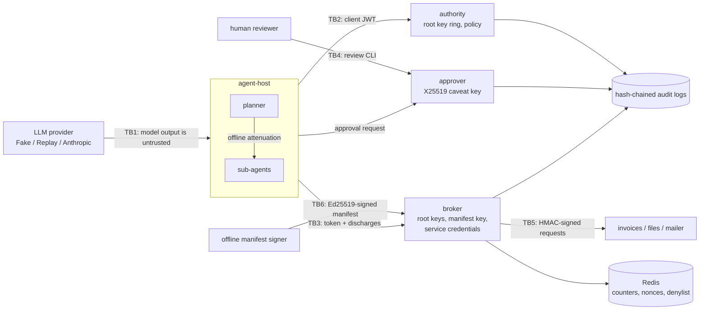

# Threat model

Method: STRIDE per trust boundary. Each row maps a threat to the control that addresses it and to
the test, bench script or CI job that shows the control works. `scripts/check_baseline.py` verifies
that every backticked evidence reference exists.

## System and trust boundaries

Assets: the root key ring (authority and broker), the approver's X25519 private key, service
credentials (broker and services), the manifest signing key (offline), client private keys (agent
host), capability tokens and discharges (bearer credentials with narrow authority), the integrity of
effects at the services, audit evidence, and spend (LLM tokens and USD).

Attacker model: a prompt injection fully controls the model's tool calls; a compromised agent host
process can read and modify its own tokens, discharges and state and call every service endpoint it
can reach; a network attacker can observe or replay traffic unless TLS is terminated in front of the
services. The broker and the authority are trusted with the root key (see ADR 0002). The approver is
trusted to show the reviewer the request it approves.

Assumptions: TLS terminates in front of every service in production; the container runtime and the
hosts of the authority and the broker are trusted; the reviewer reads the request shown by the CLI.

## STRIDE table

| ID | STRIDE | Threat | Entry point / asset | Control | Test / evidence | Residual risk |
|---|---|---|---|---|---|---|
| S1 | Spoofing | A process impersonates the agent host at the authority, broker or approver | TB2, TB3 | EdDSA client-credential JWTs; only `EdDSA` accepted (no `none`, no HMAC confusion); audience per service; lifetime at most 5 minutes; `jti` accepted once | `tests/unit/test_client_auth.py::test_valid_assertions_authenticate_once`, `tests/unit/test_client_auth.py::test_invalid_assertions_are_rejected`, `tests/unit/test_client_auth.py::test_unsigned_and_wrongly_signed_assertions_are_rejected`, `tests/integration/test_http_apps.py::test_business_endpoints_require_an_assertion_for_their_own_audience` | The replay cache is per process; several broker replicas need a shared `jti` store |
| S2 | Spoofing | A caller reaches a service directly, bypassing the broker | TB5 | Services accept only requests HMAC-signed with the broker's credential, within 30 s of their clock and with an unseen nonce | `tests/unit/test_signing.py::test_services_reject_requests_that_bypass_the_broker`, `tests/unit/test_signing.py::test_tampering_staleness_and_unknown_keys_are_rejected`, `tests/unit/test_signing.py::test_signed_requests_verify_exactly_once`, `tests/integration/test_http_apps.py::test_services_app_accepts_only_signed_requests` | Real SaaS APIs rarely verify signatures; there, network policy must keep agents away from service hosts |
| S3 | Spoofing | A holder fabricates an approval: appends its own approval-looking third-party caveat and discharges it | TB3, approvals | Approval evidence requires an authority tag (HMAC under a root-derived key over the caveat body and the caveat key hash) plus `request_hash` and `once` caveats in the discharge | `tests/integration/test_broker_pipeline.py::test_holder_made_approval_caveats_are_not_approval_evidence`, `tests/integration/test_broker_pipeline.py::test_discharges_need_both_a_request_hash_and_a_once_nonce`, `tests/integration/test_evaluation.py::test_forgery_suite_accepts_nothing` | Anyone holding the root key (authority, broker) can mint discharges |
| S4 | Spoofing | The requesting agent approves its own call, or reads another client's approval | TB4 | Separation of duties in the approval queue; requests visible only to their requester; decisions only through the local review CLI | `tests/unit/test_approver.py::test_separation_of_duties_and_single_decisions`, `tests/unit/test_approver.py::test_requesters_see_only_their_own_requests`, `tests/integration/test_http_apps.py::test_approvals_over_http_are_visible_only_to_their_requester` | Reviewer identity in the CLI is a configured string, not an authenticated login |
| T1 | Tampering | Token forgery: byte flips, removed or reordered caveats, spliced signatures, swapped identifiers | TB3, tokens | HMAC-SHA256 chain compared in constant time; strict canonical V2 parsing and base64url; unauthenticated `location` fields refused | `tests/unit/test_macaroon_library.py::test_arbitrary_bytes_either_parse_or_raise_a_format_error`, `tests/unit/test_macaroon_library.py::test_malformed_encodings_are_rejected`, `tests/unit/test_verifier.py::test_unknown_keys_and_bad_signatures_are_denied`, `tests/integration/test_evaluation.py::test_forgery_suite_accepts_nothing`, `bench/bench_baseline.py` | Security reduces to HMAC-SHA256 and key secrecy |
| T2 | Tampering | Delegation widens authority (a child asks for a wider glob, more tools or a longer lifetime) | Offline attenuation | Caveats are conjunctive and cannot be removed; every child's authorized set is a subset of its parent's, checked against an independent exhaustive oracle | `tests/integration/test_evaluation.py::test_authorized_sets_equal_the_oracle_and_children_only_narrow`, `tests/unit/test_caveats.py::test_every_predicate_has_exactly_one_canonical_encoding`, `tests/unit/test_glob.py::test_glob_matching_equals_the_reference_matcher`, `bench/bench_baseline.py` | The oracle universe is finite (900 requests); properties outside it rely on the same code paths |
| T3 | Tampering | Discharge replay, or reuse on another request, token family or task | TB3, discharges | Discharge bound to the root signature; `request_hash` of the canonical request; `once` nonce committed atomically; discharges that match no caveat are refused | `tests/integration/test_broker_pipeline.py::test_writes_need_an_approval_for_the_exact_request_and_run_once`, `tests/unit/test_verifier.py::test_third_party_caveats_need_a_valid_discharge_bound_to_the_token`, `tests/integration/test_evaluation.py::test_escalation_suite_broker_versus_ambient_keys` | Until `once` is committed a discharge is a bearer credential for exactly one call; expiry is at most 2 minutes |
| T4 | Tampering | The tool manifest is modified, for example a write tool relabeled as read to skip approval | TB6, manifest | Ed25519-signed manifest with pinned key ids; the broker denies every call and `/readyz` fails without a valid signature; verb and host come only from the manifest | `tests/unit/test_manifest.py::test_modified_unsigned_or_untrusted_manifests_are_refused`, `tests/unit/test_manifest.py::test_holder_reports_readiness_from_the_file`, `tests/integration/test_http_apps.py::test_broker_readiness_fails_without_a_verified_manifest` | The manifest signing key must stay offline; a wrong but signed manifest is trusted |
| T5 | Tampering | Arguments changed between human approval and execution, or an approval record edited on disk | TB4, approval queue | The discharge carries the hash of the canonical request (tool, verb, host, resource, arguments, task); queue records must hash to their stored request | `tests/unit/test_approver.py::test_approval_mints_a_discharge_bound_to_the_exact_request`, `tests/unit/test_approver.py::test_a_persisted_queue_is_shared_and_refuses_tampered_records` | A reviewer can approve a malicious request that is displayed faithfully |
| T6 | Tampering | Audit entries edited, deleted or reordered | Audit logs | Hash chain over canonical JSON, verify CLI, head anchoring, file locks for concurrent writers | `tests/unit/test_audit.py::test_any_single_byte_change_is_detected`, `tests/unit/test_audit.py::test_tail_truncation_needs_an_anchored_head`, `tests/integration/test_demos_cli.py::test_demo_contains_the_injection_and_runs_one_approved_write` | A writer with file access can rebuild the chain; ship the head hash elsewhere |
| T7 | Tampering | Compromised dependency, base image or CI action | Build pipeline | uv.lock with hashes, pip-audit, digest-pinned base images, trivy, CycloneDX SBOM, Dependabot | `.github/workflows/ci.yml#pip-audit`, `.github/workflows/ci.yml#docker` | Actions and the compose Redis image are tag-pinned until publication |
| R1 | Repudiation | Dispute over who minted, delegated, was denied, approved or executed what | All roles | Audit entries for `authority.mint`, `agent.attenuate`, `broker.deny` (with the failing caveat), `approver.requested`, `approver.discharge`, `broker.execute` | `tests/integration/test_broker_pipeline.py::test_decisions_are_audited_with_the_failing_caveat`, `tests/integration/test_demos_cli.py::test_demo_contains_the_injection_and_runs_one_approved_write` | Timestamps come from each host's clock |
| I1 | Information disclosure | Ambient authority: the agent host or the approver can read service credentials or root keys | Process environment, memory | Per-role settings classes and compose environments; object-graph inspection of a running agent host and approver | `tests/integration/test_no_ambient_authority.py::test_compose_hands_each_secret_only_to_its_role`, `tests/integration/test_no_ambient_authority.py::test_role_settings_cannot_load_other_roles_secrets`, `tests/integration/test_no_ambient_authority.py::test_a_running_agent_host_holds_only_capabilities`, `tests/integration/test_no_ambient_authority.py::test_the_approver_holds_no_root_keys_or_service_credentials` | Process isolation of tool code is out of scope (a same-host compromise sees whatever runs there) |
| I2 | Information disclosure | A stolen token (from a transcript or log) is used by someone else | TB3 | `client` caveat checked against the JWT-authenticated caller; short expiry; revocation by token id | `tests/integration/test_broker_pipeline.py::test_denials_name_the_failing_caveat_and_never_reach_a_service`, `tests/integration/test_broker_pipeline.py::test_expired_and_revoked_tokens_are_denied` | A thief who also holds the client key acts with the token's authority until it expires |
| I3 | Information disclosure | PII or secrets written to logs, traces or audit records | Logs, audit | Redacting structlog and stdlib pipeline; audit data redacted before hashing | `tests/unit/test_redaction.py::test_known_secret_and_pii_formats_are_redacted`, `tests/unit/test_logging.py::test_exception_tracebacks_are_redacted`, `tests/unit/test_audit.py::test_entries_are_redacted_before_hashing` | Pattern-based: names and free-form identifiers are not detected |
| I4 | Information disclosure | Error bodies echo submitted values or internals | HTTP responses | Fixed error codes; argument problems reported by name only; validation errors without input | `tests/integration/test_broker_pipeline.py::test_invalid_requests_are_rejected_without_echoing_values`, `tests/integration/test_app.py::test_validation_errors_never_echo_submitted_values`, `tests/integration/test_app.py::test_unhandled_exceptions_become_generic_500s` | Denials disclose the failing caveat, which the holder can already read in its own token |
| I5 | Information disclosure | Terminal escape sequences in arguments hide what the reviewer approves | TB4, review CLI | Control characters escaped in every agent-supplied string shown by the CLI | `tests/unit/test_approver.py::test_review_cli_shows_escaped_requests_and_records_decisions` | Very long arguments can still be tedious to review |
| D1 | Denial of service | Request floods | HTTP roles | Token-bucket rate limiting per verified key or client address | `tests/integration/test_app.py::test_rate_limit_rejects_bursts_and_exempts_probes`, `tests/integration/test_app.py::test_invalid_keys_cannot_mint_fresh_rate_limit_buckets` | In-process buckets; replicas need a shared limiter |
| D2 | Denial of service | Oversized bodies, tokens, caveat lists or upstream outputs | HTTP roles, broker | Body size limit; token, field and caveat count limits; output capped per manifest entry | `tests/integration/test_app.py::test_body_size_limit_applies_to_declared_and_streamed_bodies`, `tests/unit/test_macaroon_library.py::test_size_limits_are_enforced`, `tests/integration/test_broker_pipeline.py::test_large_outputs_are_capped` | Large-but-valid tokens still cost a verification |
| D3 | Denial of service | A holder appends a hostile glob caveat that makes matching backtrack | Verifier | Glob matching without regular expressions in O(pattern x value) time | `tests/unit/test_glob.py::test_hostile_patterns_match_in_bounded_time` | None known |
| D4 | Denial of service | Runaway agents, or delegation used to multiply call budgets | Broker state, budgets | `max_calls` counters keyed by the chain prefix, so copies share them; atomic commits; denials do not consume quota; task budgets shared by sub-agents | `tests/integration/test_broker_pipeline.py::test_call_counters_are_shared_by_attenuated_copies_and_not_burned_by_denials`, `tests/unit/test_state_store.py::test_concurrent_commits_never_exceed_the_limit`, `tests/integration/test_agent_host.py::test_sub_agents_draw_from_the_task_budget` | A token without `max_calls` is limited only by expiry and rate limits |
| D5 | Denial of service | Redis is unavailable or contended | Broker state | Fail closed: calls needing state are denied with `state_unavailable`; `/readyz` reports the store | `tests/unit/test_state_store.py::test_redis_outages_fail_closed`, `tests/integration/test_broker_pipeline.py::test_the_broker_fails_closed`, `tests/integration/test_http_apps.py::test_roles_build_their_apps_from_the_environment` | Availability depends on Redis |
| E1 | Elevation of privilege | Prompt injection makes a model call tools or resources outside its task | TB1 | Enforcement at the broker with the calling agent's capability token; tested with a scripted model that obeys every injected instruction, against an ambient-credential baseline | `tests/integration/test_agent_host.py::test_the_injected_sub_agent_is_contained_and_the_write_waits_for_a_human`, `tests/integration/test_evaluation.py::test_escalation_suite_broker_versus_ambient_keys`, `bench/bench_baseline.py` | Actions inside the token's authority remain possible; approvals cover writes and deletes only |
| E2 | Elevation of privilege | Confused deputy: the broker applies its credentials to a request the agent is not authorized for | Broker | Verb and host from the signed manifest; resources mapped onto routes only through manifest templates; caveats evaluated on the canonical request; required caveat types per tool | `tests/integration/test_broker_pipeline.py::test_the_agent_cannot_choose_verb_or_host`, `tests/unit/test_manifest.py::test_resources_map_onto_routes_only_through_the_template`, `tests/integration/test_broker_pipeline.py::test_manifest_required_caveats_reject_overly_broad_tokens` | Services must interpret paths the way the manifest assumes |
| E3 | Elevation of privilege | Policy parameters smuggle wildcards into resource globs | Authority | Parameter values must be literal resource segments and match the template pattern | `tests/unit/test_authority.py::test_parameter_values_can_never_widen_a_resource_glob`, `tests/unit/test_authority.py::test_clients_and_templates_are_enforced` | The policy file itself is trusted configuration |
| E4 | Elevation of privilege | A root key is compromised or must be rotated | Key ring | Key ids in identifiers, dual-key rotation window, documented runbook | `tests/integration/test_key_rotation.py::test_dual_key_rotation_window` | Rotation invalidates tokens only after removal; emergency removal invalidates all outstanding tokens |
| E5 | Elevation of privilege | Code execution inside a container escalates | Runtime | Non-root UID 10001, read-only root filesystem, all capabilities dropped, no-new-privileges, resource limits | `.github/workflows/ci.yml#docker`, `.github/workflows/ci.yml#compose-integration` | Kernel or runtime vulnerabilities |
